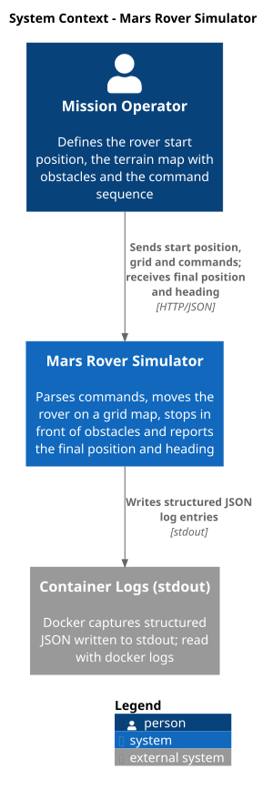

# 3. System Scope and Context

## 3.1 Business Context

The Mars Rover Simulator is a self-contained HTTP service. Its only external actor
is the Mission Operator, who submits a simulation request and receives the result.
The service writes structured execution logs to stdout (read with `docker logs`)
but reads nothing from any external system; every piece of information needed to
run a simulation is supplied in the request body.

The table below defines what crosses the system boundary.

| Interaction | Direction | Content |
|-------------|-----------|---------|
| Simulation request | Operator → System | Start position `(x, y)`, heading, grid dimensions, obstacle list, command string |
| Simulation response | System → Operator | Final position, heading, list of blocked commands (index + reason), or a validation error |
| Execution log | System → container stdout | Structured JSON log entry per request: input summary, outcome, any blocked commands, duration; read with `docker logs` |

## 3.2 Technical Context

| Channel | Protocol / Technology | Notes |
|---------|-----------------------|-------|
| Operator ↔ System | HTTP / JSON via FastAPI served by Uvicorn in a Docker container | Single `POST /simulate` endpoint; OpenAPI schema generated by FastAPI from the route adapter's models |
| System → container stdout | stdout, captured by Docker | The Logger Adapter writes structured JSON to stdout; `docker logs` reads it. No SDK call, log shipper, or cloud service is involved |

## 3.3 System Context Diagram

The diagram shows:

- **Mission Operator** — the human (or automated client) who calls the API.
- **Mars Rover Simulator** — the system under design; everything inside this boundary is built and owned by this project.
- **Container Logs (stdout)** — the Docker runtime captures the structured JSON the system writes to stdout and exposes it via `docker logs`; the system writes to it but does not read from it.

## 3.4 Scope and Out-of-Scope

**In scope**

- Input validation (FR-7) and simulation execution (FR-4 through FR-6)
- The HTTP API endpoint and FastAPI route adapter
- Structured JSON logging to stdout / container logs

**Out of scope**

- Simulation history or replay (no storage in the MVP; see ADR-001)
- Authentication and authorisation of the operator (the API is unauthenticated in the MVP; this is noted as a risk in Chapter 11)
- A graphical front-end or map visualisation
- Rover autonomy or path planning beyond executing the supplied command list
- Cloud accounts, IAM, serverless platforms, and cloud infrastructure-as-code (the service runs in a Docker container; CI/CD only publishes the image to GHCR)
