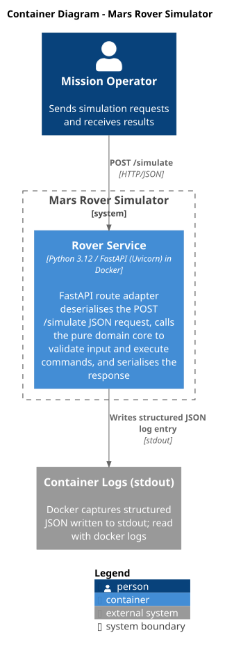
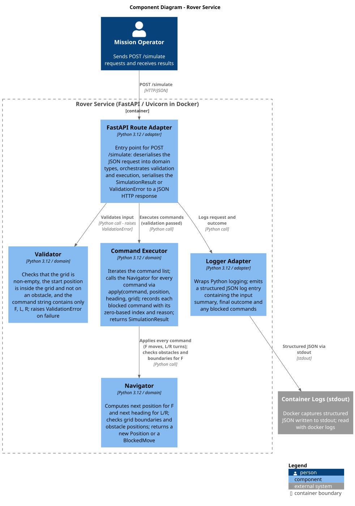

# 5. Building Block View

## 5.1 Whitebox Overall System (C4 Level 2 - Container)

The Mars Rover Simulator consists of a single container, the **Rover Service**: a
Python 3.12 FastAPI application served by Uvicorn in a Docker container. Container
logs are external because they are captured by the Docker runtime, not owned by
the system.



| Container | Technology | Responsibility |
|-----------|-----------|---------------|
| Rover Service | Python 3.12 / FastAPI served by Uvicorn in Docker | Hosts the FastAPI route adapter and the pure domain core; exposes `POST /simulate`, validates input, executes commands and serialises the response |

**Deployment unit:** the `Dockerfile` and `docker-compose.yml` define the image and
its runtime. `docker run` or `docker compose up` starts it locally; CI/CD builds the
image and publishes it to GHCR. There is no API gateway or function to deploy
separately.

## 5.2 Whitebox Rover Service (C4 Level 3 - Component)

The Rover Service contains five components arranged in two rings consistent with the
hexagonal architecture described in Chapter 4.2.

**Adapters** (touch the outside world): FastAPI Route Adapter, Logger Adapter.
**Domain core** (pure Python, no I/O): Validator, Command Executor, Navigator.



### Component responsibilities

| Component | Ring | Responsibility |
|-----------|------|---------------|
| **FastAPI Route Adapter** | Adapter | Entry point for every request. Deserialises the `POST /simulate` JSON body into domain types (`Grid`, `Position`, `Heading`, `Command` list). Calls `Validator`, then — only if validation passes — calls `Command Executor`. Serialises the result (`SimulationResult` or `ValidationError`) into an HTTP JSON response with the appropriate status code (200 / 400). |
| **Validator** | Domain | Enforces FR-7: rejects an empty grid, a start position outside the grid, a start position coinciding with an obstacle, and any unrecognised command character. Raises `ValidationError` with a descriptive message; does not call any other component. |
| **Command Executor** | Domain | Enforces FR-4 and FR-5. Iterates the command list in order. For every command it calls the Navigator via `apply(command, position, heading, grid)`. For `F` commands the Navigator returns either a new `Position` or a `BlockedMove`; the Executor records blocked moves (zero-based index + reason) and keeps the rover's current position and heading. For `L` and `R` commands the Navigator returns a new `Heading`. Returns a `SimulationResult` containing the final `Position`, `Heading`, and the list of `BlockedMove` entries (FR-6). |
| **Navigator** | Domain | Handles all three command types. For `F`: computes the candidate next position and checks whether it falls outside the grid (reason: `boundary`) or coincides with an obstacle (reason: `obstacle`); returns a new `Position` or a `BlockedMove`. For `L` and `R`: computes and returns the new `Heading` after a 90° turn. |
| **Logger Adapter** | Adapter | Wraps Python's `logging` module. Called by the FastAPI Route Adapter before returning. Emits a single structured JSON log entry to stdout containing: input summary (grid size, start, command count), final position and heading, blocked command list, and invocation duration. Docker captures stdout; `docker logs` reads it. |

### Domain types

The following types are defined in the domain core and are shared across components.
They carry no framework dependencies.

| Type | Kind | Description |
|------|------|-------------|
| `Position` | dataclass | `x: int`, `y: int` — zero-based grid coordinates |
| `Heading` | enum | `N`, `S`, `E`, `W` |
| `Command` | enum | `F`, `L`, `R` |
| `Grid` | dataclass | `width: int`, `height: int`, `obstacles: frozenset[Position]` |
| `SimulationRequest` | dataclass | Aggregates `Position`, `Heading`, `Grid`, and `list[Command]` — the validated input |
| `BlockedMove` | dataclass | `index: int`, `reason: Literal["obstacle", "boundary"]` |
| `SimulationResult` | dataclass | `position: Position`, `heading: Heading`, `blocked: list[BlockedMove]` |
| `ValidationError` | exception | `message: str` — raised by `Validator`, caught by `FastAPI Route Adapter` |

## 5.3 Source Layout

The package structure follows the hexagonal boundaries directly.

```
src/
  rover/
    main.py             # FastAPI app (POST /simulate), served by Uvicorn
    domain/
      model.py          # Position, Heading, Command, Grid, SimulationRequest,
                        # BlockedMove, SimulationResult, ValidationError
      validator.py      # Validator
      executor.py       # CommandExecutor
      navigator.py      # Navigator
    adapters/
      route.py          # FastAPI Route Adapter (request/response and error mapping)
      logger.py         # Logger Adapter
tests/
  unit/
    domain/
      test_validator.py
      test_executor.py
      test_navigator.py
  bdd/
    features/
      simulate.feature  # pytest-bdd scenarios for FR-4 through FR-7
    test_simulate.py    # step definitions
Dockerfile              # Builds the Rover Service image
docker-compose.yml      # Local run: docker compose up
```

Domain tests never import anything from `rover.adapters`; adapter tests call the route
through FastAPI's `TestClient` with a synthetic JSON request.
