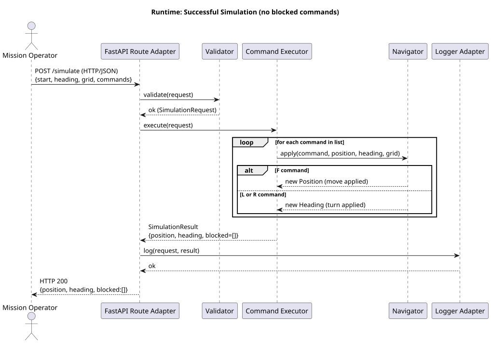
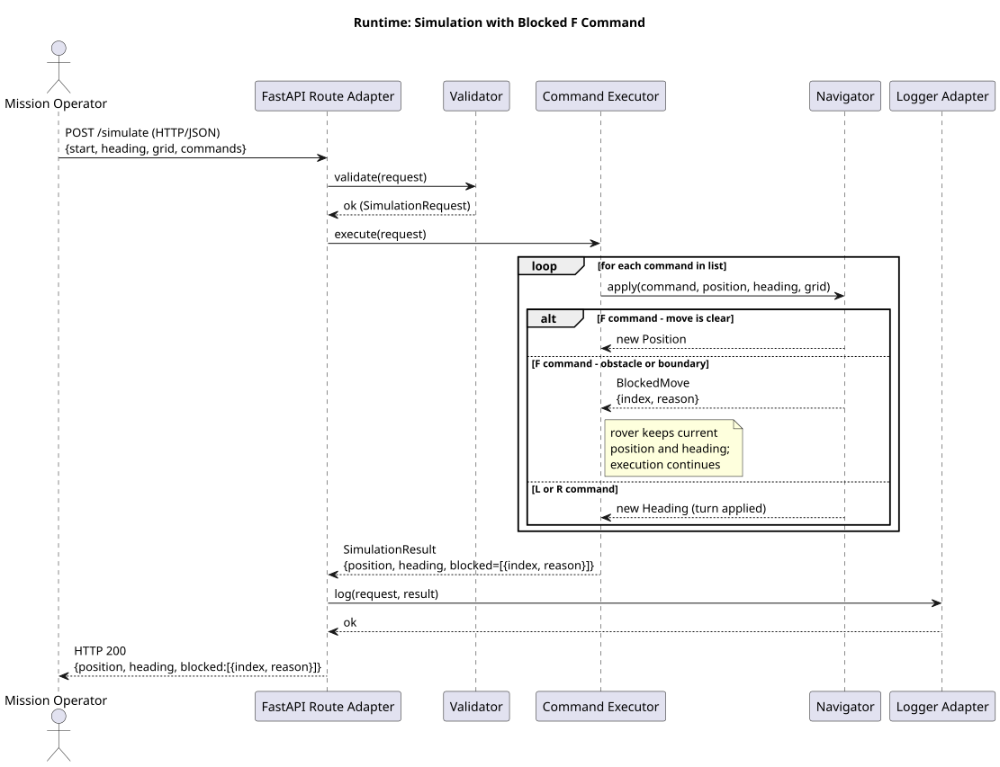
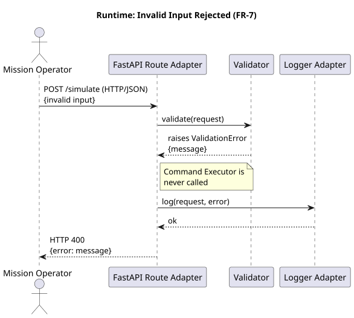

# 6. Runtime View

This chapter describes the three runtime scenarios that together cover every
execution path through the system. Each scenario maps directly to one or more
BDD scenarios in `tests/bdd/features/simulate.feature`.

## 6.1 Scenario: Successful Simulation (Happy Path)

**Trigger:** The Mission Operator sends a `POST /simulate` request with valid input
and a command sequence that does not encounter any obstacle or boundary.

**Outcome:** HTTP 200 with the final position, heading, and an empty `blocked` list.

**Key points:**

- The FastAPI Route Adapter deserialises the JSON request body and passes a `SimulationRequest` to the Validator.
- The Validator returns without raising; the Route Adapter then calls the Command Executor.
- The Executor iterates every command and calls `Navigator.apply` for each one. For `F` commands the Navigator returns a new `Position`; for `L` and `R` commands it returns a new `Heading`. No `BlockedMove` is produced.
- The Executor returns a `SimulationResult` with `blocked=[]`.
- The Route Adapter passes the result to the Logger Adapter, then serialises the result to HTTP 200.

## 6.2 Scenario: Blocked F Command

**Trigger:** The Mission Operator sends a `POST /simulate` request with valid input
and a command sequence where at least one `F` command would move the rover onto an
obstacle or outside the grid.

**Outcome:** HTTP 200 with the final position, heading, and a non-empty `blocked`
list. The rover's position and heading at the time of each block are preserved; execution
continues with the next command (FR-5).

**Key points:**

- Validation succeeds; the Route Adapter calls the Executor normally.
- The Executor calls `Navigator.apply` for every command. For `L` and `R` the Navigator returns a new `Heading`. For an `F` that is clear, the Navigator returns a new `Position`. For an `F` that would hit an obstacle or leave the grid, the Navigator returns a `BlockedMove{index, reason}` — reason is `obstacle` or `boundary`.
- The Executor records the `BlockedMove`, leaves the rover's position and heading unchanged, and moves on to the next command.
- The final `SimulationResult` includes all `BlockedMove` entries accumulated during the run.
- The response status is still 200; a blocked move is a valid simulation outcome, not an error.

## 6.3 Scenario: Invalid Input Rejected (FR-7)

**Trigger:** The Mission Operator sends a `POST /simulate` request with invalid
input — an empty grid, a start position outside the grid or on an obstacle, or a
command string containing unknown characters.

**Outcome:** HTTP 400 with a `{"error": "<message>"}` body. No simulation is run.

**Key points:**

- The Validator raises `ValidationError` with a descriptive message.
- The FastAPI Route Adapter catches `ValidationError` before invoking the Command Executor; the Executor and Navigator are never called.
- The Logger Adapter is still called so that rejected requests appear in the container logs (`docker logs`) alongside successful ones.
- The Route Adapter serialises the error message to an HTTP 400 response.

## 6.4 Component Interaction Summary

| Step | Caller | Callee | Always? |
|------|--------|--------|---------|
| 1 | Mission Operator | FastAPI Route Adapter | Yes |
| 2 | FastAPI Route Adapter | Validator | Yes |
| 3 | FastAPI Route Adapter | Command Executor | Only if validation passes |
| 4 | Command Executor | Navigator | Once per command in the list |
| 5 | FastAPI Route Adapter | Logger Adapter | Yes (success and error) |
| 6 | Logger Adapter | container stdout (`docker logs`) | Yes |
