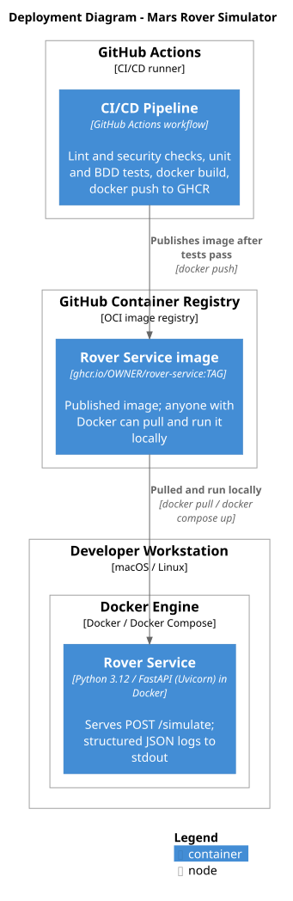

# 7. Deployment View

## 7.1 Infrastructure Overview

The Mars Rover Simulator runs as a single Docker container on a local Docker Engine.
There is no cloud account, no server fleet, and no infrastructure-as-code platform.
The image is built from the `Dockerfile`, run locally with `docker compose`, and
published to GitHub Container Registry (GHCR) by the CI/CD pipeline.



## 7.2 Deployment Nodes

| Node | Technology | Role |
|------|-----------|------|
| Developer Workstation | Docker Engine, Docker Compose, pytest | Runs the Rover Service container locally (FastAPI/Uvicorn on a local port), executes unit and BDD tests, and smoke-tests `POST /simulate` against the local container |
| GitHub Actions | CI/CD runner (workflow YAML) | On every push and pull request: lint and security checks, unit and BDD tests, `docker build`, and `docker push` of the image to GHCR |
| GitHub Container Registry (GHCR) | OCI image registry | Stores the published image by tag; anyone with Docker can `docker pull` and `docker run` it without a cloud account |

## 7.3 Container Configuration

| Parameter | Value | Rationale |
|-----------|-------|-----------|
| Base image | `python:3.12-slim` | Matches TC-1; small footprint |
| Application server | `uvicorn rover.main:app` | Serves the FastAPI application (ADR-009) |
| Exposed port | 8000 (host mapping configured in `docker-compose.yml`) | Uvicorn default; local HTTP access to `POST /simulate` |
| Image build | `docker build` from the repository `Dockerfile` | Reproducible, self-contained artefact; no SAM or CloudFormation |
| Runtime configuration | Environment variables, e.g. `LOG_LEVEL` (default `INFO`) | Only non-secret runtime configuration needed; no hard-coded values (TC-8) |
| Logs | Structured JSON to stdout, read with `docker logs` | Standard container log channel; TC-6 |

## 7.4 Image Registry and Access

There are no IAM roles and no cloud permissions. The published artefact is an OCI
image in GHCR:

| Concern | Approach | Reason |
|---------|----------|--------|
| Registry access | GitHub Actions pushes with the automatic `GITHUB_TOKEN` (`packages: write`); public images can be pulled without credentials, private images need a GitHub PAT | No cloud IAM; GHCR is the single artefact store |
| Image tags | Commit SHA for immutable identification, plus `latest` on `main` | Traceability from image to commit; supports the "published image tag" environment |
| Secrets | None beyond the automatic `GITHUB_TOKEN`, which is never printed in logs | TC-8; no long-lived cloud credentials to leak |

## 7.5 Deployment Pipeline

The CI/CD pipeline runs on GitHub Actions on every pull request and on every merge to `main`:

```
1. Install dependencies   pip install -r requirements.txt
2. Pre-commit checks      black, isort, ruff, bandit, detect-secrets
3. Unit tests             pytest tests/unit/
4. BDD tests              pytest tests/bdd/
5. Docker build           docker build -t ghcr.io/<owner>/rover-service:<sha> .
6. Push to GHCR           docker push ghcr.io/<owner>/rover-service:<sha>
7. Smoke test             docker run the image and curl POST /simulate; assert expected output
```

Publishing only happens after tests pass on `main`; pull requests run stages 1–4
(and a build check) but do not push. No cloud credentials are involved. The developer
workstation never pushes images by hand; publishing goes through the pipeline exclusively.

## 7.6 Environments

| Environment | Identifier | Trigger |
|-------------|-----------|---------|
| Local | `docker compose up` on the workstation | Developer runs it on demand; no approval |
| Published image tag | `ghcr.io/<owner>/rover-service:<git-sha>` (and `latest` on `main`) | CI/CD pipeline after tests pass on merge to `main` |

There are no CloudFormation stacks, IAM roles, API Gateway stages, or Dev/Prod cloud
environments. A "deployment" now means pulling a published tag and running it with Docker.
